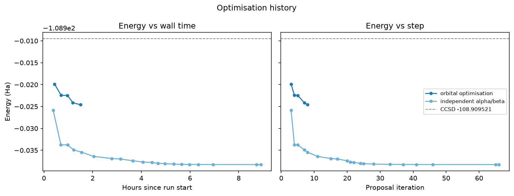

# N₂ ground state with SQD, Qiskit Fall Fest 2026 Warsaw, Track 4

Team: Bartosz Podliński

**Result: -108.938468 Ha** (recomputed with the grader's local check, `matches=True`).

| | Energy (Ha) |
|---|---:|
| Hartree-Fock | -108.330583 |
| Lab baseline (Exercise 4) | -108.789 |
| CCSD | -108.909521 |
| **This submission** | **-108.938468** |
| FCI (Eriksen & Gauss, JCTC 2019) | -108.98203 |

That is 28.9 mHa below CCSD and 93.3 % of the correlation energy, with 300 α and 300 β
strings.

## Idea

The grader diagonalises the exact Hamiltonian in the 300 x 300 product of the submitted
strings, so the energy is variational and depends only on which strings are chosen and in
which orbital basis they are written. Full CI here has about 4.3 billion determinants; the
subspace has 90 000.

I did two things:

1. **Choose the strings classically, by coupling.** Start from Hartree-Fock plus singles and
   doubles. In each iteration, score the single and double excitations of the current strings
   by their coupling to the current wavefunction (an Epstein-Nesbet-type weight), add 100,
   diagonalise, and prune back to 300 by weight. In the notebook's orbitals this stops at
   -108.915 Ha. Every string removed costs energy, so the 300-string limit is what holds it
   back.
2. **Rotate the orbitals so the same 300 strings capture more.** Natural orbitals of the
   subspace wavefunction first, then `ffsim.optimize_orbitals` (real rotation, 325
   parameters) alternating with the string selection. After each rotation the wavefunction is
   re-expressed exactly in the new basis (5 x 5 overlap minors per spin) before re-selecting.
   A rotation `U` of the 26 active orbitals leaves the Hamiltonian and its exact spectrum
   unchanged; core orbitals and the core energy are untouched. A final basin-hopping pass
   over the strings, with `U` fixed, gives the submitted state.

| Step | Energy (Ha) |
|---|---:|
| HF + singles + doubles | -108.862724 |
| String selection, notebook orbitals | -108.914953 |
| + natural orbitals | -108.919881 |
| + orbital optimisation | -108.924135 |
| + independent α/β selection | -108.938278 |
| + basin hopping (submitted) | **-108.938468** |

With the orbitals held fixed, the same search ends at -108.915506 Ha, so the basis is worth
about 23 mHa. No QPU time was used: the configurations come from the classical selection
instead of LUCJ samples.



Details and plots: [notebooks/track4.ipynb](notebooks/track4.ipynb).

## Submission files

`submission/` contains the rotation `U` (`rotation.npy`, real orthogonal 26 x 26, same for
both spins), the starting integrals (`canonical_hcore.npy`, `canonical_eri.npy`), the
submitted rotated integrals (`hcore.npy`, `eri.npy`), the CI strings (`ci_strs_a.npy`,
`ci_strs_b.npy`) and `manifest.json` (energy, core energy, sha256 of every file).

```
hcore = U.T @ canonical_hcore @ U
eri[p,q,r,s] = sum_abcd U[a,p] U[b,q] U[c,r] U[d,s] canonical_eri[a,b,c,d]
```

Check that `U` is orthogonal, that it reproduces the submitted integrals exactly, and
recompute the energy with the grader's check:

```powershell
scripts/dock.ps1 python scripts/verify_rotation.py submission
```

The starting integrals come from my RHF run of the lab's N₂ setup. A fresh RHF run fixes the
degenerate orbital pairs differently, so it matches them through the grader's spectra check,
not element by element.

## How `U` and the strings were produced

```powershell
# string selection in the notebook's orbitals -> cand_Em108p914953
scripts/dock.ps1 python scripts/interim_select_A.py --seed hfsd --hours 6
# natural orbitals + orbital optimisation + selection -> cand_Em108p924135
scripts/dock.ps1 python scripts/optimise.py --track B --hours 20 --threads 8 --start results/cand_Em108p914953_20261023T220349Z_A_quick_it6.npz
# same, independent alpha/beta sets -> final U, cand_Em108p938278
scripts/dock.ps1 python scripts/optimise.py --track B --independent --hours 14 --threads 8 --start results/cand_Em108p924135_20261023T232958Z_B_run1d9fa1ba_it0007_rot_ffsim_sameset.npz
# basin hopping on the strings, U fixed -> submitted candidate
scripts/dock.ps1 python scripts/basin_hop_B.py --start results/cand_Em108p938278_20261024T082506Z_B_run23ed77e0_it0066_swap.npz --kick 30 --kick-seed 201 --n-add 30 --prune energy --hours 1.2
scripts/dock.ps1 python scripts/basin_hop_B.py --start results/cand_Em108p938468_20261024T211015Z_B_hopB_k30s201_n30_energy_ind.npz --kick 30 --kick-seed 202 --n-add 30 --prune energy --hours 1.2
# write submission/ from the final candidate
scripts/dock.ps1 python scripts/export_submission.py results/cand_Em108p938468_20261024T221615Z_B_hopB_k30s202_n30_energy_ind.npz
```

Each candidate in `results/` stores its strings, integrals, `U` and parent file. The long runs
are time-limited and multi-threaded, so a re-run can stop at a slightly different point; the
stored `rotation.npy` is the one that was submitted.

One energy evaluation (300 x 300) takes 1-4 minutes on a laptop (Ryzen 9 4900H, 8 threads).

## Environment

pyscf, ffsim and qiskit-addon-sqd do not run on native Windows, so everything runs in Docker
(`python:3.13-slim`, versions pinned in `requirements.txt` and `requirements.lock`; pyscf
2.14.0, ffsim 0.0.84, qiskit-addon-sqd 0.14.0, qiskit 2.6.1, qfest-grader 0.3.0).

```powershell
docker build -t n2-sqd .
scripts/dock.ps1 jupyter    # JupyterLab on http://localhost:8888
```

On Linux or macOS `pip install -r requirements.txt -c requirements.lock` should also work.

Submitting to the grader (it recomputes the energy locally, so run it in the image):

```powershell
scripts/dock.ps1 python scripts/submit_bonus.py results/cand_Em108p938468_20261024T221615Z_B_hopB_k30s202_n30_energy_ind.npz --send --email <email>
```

## Licence

MIT.
